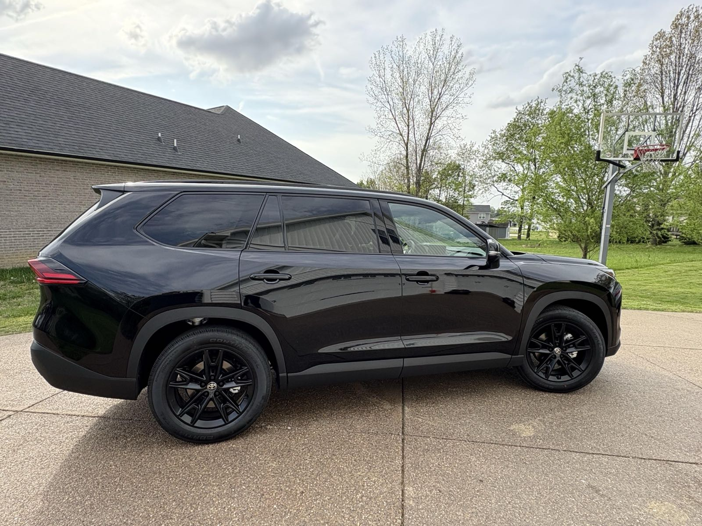
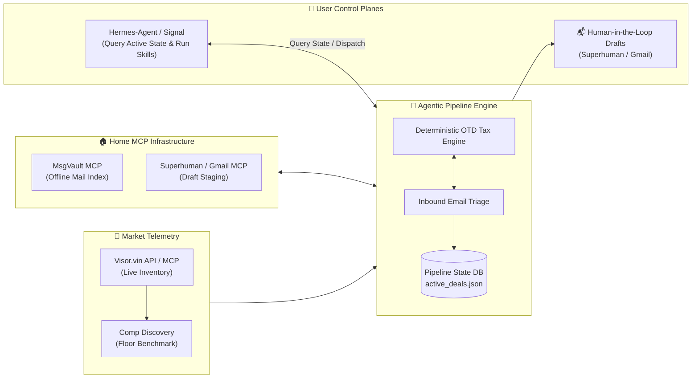

## Dear Lord Why?

Because I hate *knowing* that the car dealership is screwing me, *AND* I have buying constraints on acceptable models / controls. Rather than build the dealer API integration myself, after some complaining on Reddit, I stumbled upon [Visor.vin](https://visor.vin) (built by Colin and the team, reachable at [brothers@visor.vin](mailto:brothers@visor.vin)).

## Was there a happy ending?

Yes. I'm scheduled to take possession of a [Toyota Grand Highlander](https://www.toyota.com/grandhighlander/) 2026 Hybrid Nightshade in November.


*2026 Toyota Grand Highlander Hybrid Nightshade Edition (Midnight Black Metallic)*

AI has assisted the detailed write-up (and, fittingly, the negotiation). Thanks to Colin and the Visor.vin team for the inventory API, and to [kenn-io](https://github.com/kenn-io/msgvault) for the original msgvault.

<!-- truncate -->

## What was hard about it?

Getting Hermes and Antigravity to execute the same skill consistently across agent runtimes using the [AgentSkills specification](https://github.com/5L-Labs/agent-skills).

[FIXME: 3–5 sentences on what actually broke between runtimes — e.g. skill discovery paths, tool-call formats, one runtime freelancing instead of calling the deterministic scripts — and how you pinned it down. This is the most interesting technical story in the post.]

## Is negotiating a car purchase a home IoT project?

It's a stretch, unless you view the home through **Home Operations (Home-Ops)**: managing high-capital household procurement on infrastructure you control, keeping your mail index and deal state local rather than in yet another SaaS.

What stays local: the msgvault mail index, the OTD/finance engine, and the deal state file. What doesn't: outbound drafts live in Superhuman / Gmail, and inventory queries go to the Visor.vin API.

## Components

1. **Live Mailbox ([Superhuman](https://superhuman.com) | [Gmail](https://mail.google.com) via MCP):** For staging and reviewing outbound dealer drafts with human-in-the-loop oversight. [FIXME: link to the Superhuman and Gmail MCP docs pages rather than the product homepages, if public docs exist.]
2. **[msgvault](https://github.com/NickJLange/msgvault)** (our fork of [kenn-io/msgvault](https://github.com/kenn-io/msgvault)): Offline sync of mail, minimizing upstream MCP/API calls to mail providers, with an Nginx TLS terminator in front of the local MCP daemon.
3. **[Visor.vin API](https://visor.vin):** Spun up by Colin; it pulled this all together and removed the need to scrape dealer websites with agents. (An API key from your Visor account is required.)

## General Flow Chart



## Architecture & Heuristics

Instead of letting an LLM hallucinate sales correspondence, we enforced strict separation of concerns:

1. **Market Telemetry:** Queries nationwide dealer inventory via the **Visor.vin API / MCP server**, resolving direct dealership Vehicle Detail Pages (VDP), contact forms, and competitor comp URLs.
2. **Opening Floor Bid:** Never anchor to MSRP. The engine computes a firm floor (details below), and outreach pitches anchor directly to that number, backed by verified competitor comp URLs.
3. **Pluggable MCP & Strict Safeguards:**
   - **Inbound Triage:** Indexed via local MsgVault MCP (or Gmail search fallback).
   - **Outbound Staging:** Drafts are staged into Superhuman or Gmail via MCP.
   - **Human-in-the-Loop:** The agent **never sends emails** autonomously and has zero access to payment rails. A human reviews every worksheet and clicks Send.

<details>
<summary>The Floor Bid formula</summary>

`Floor Bid OTD = Lowest National Benchmark + Local Capped Doc Fee + State Tax + DMV Reg`

The national benchmark is the cheapest active comparable listing from Visor.vin. Doc fee, tax, and registration are your local numbers, so the result is what *your* out-the-door price would be if a local dealer matched the best deal in the country.

</details>

## Real-World Triage

When a dealer sent an allocation quote sheet, running the `negotiator` skill (`python research/negotiator/scripts/finance_engine.py` paired with `negotiator_tool.py`) instantly flagged:

- **Spec Mismatch:** Quoted 2.4L Turbo Hybrid MAX (27 MPG) vs. our target 2.5L Hybrid (36 MPG).
- **OTD Spread:** $70,095 quote vs. $58,451 target, a **+$11,644 (+19.9%) markup**.
- **Financing:** 4.99% APR quoted vs. the 2.0% promotional rate. Assuming $0 down over 48 months, that's ~$1,614/mo vs. ~$1,268/mo on our target, roughly **$16,600 more in total payments**. Of that, ~$12,100 is the markup and ~$4,500 is the rate alone (the same $70,095 at 2.0% would be ~$1,521/mo).

tldr; Double Check your agent's math - ask them to use a math tool to ensure things are calculated correctly.

The agent staged an itemized counter-worksheet rejecting the markup. Two weeks later, an allocation almost exactly matching our spec arrived at our target OTD. But the color was wrong.... **FAIL**

In the end, I've placed a refundable reservation for the nightshade locally - not far from our Target OTD. Sadly, these cars sell like hotcakes, so I ended up having to call a dealership and arrange the last mile by hand. 

### What I'm thinking about

I have developed a dependency on the agent calculating the numbers for me to be confident. More about lack of trust in the dealer than my ability to calculate rough numbers.

## Open-Source Skills

The modular skills powering this workflow are published in the [5L-Labs/agent-skills](https://github.com/5L-Labs/agent-skills) repository under `research/`:

- **[`research/car_tracker`](https://github.com/5L-Labs/agent-skills/tree/main/research/car_tracker):** Daily market bulletin scanner built on `publish_deals.py` that polls the Visor API for new arrivals, caches seen inventory in local state, and highlights target trims against baseline OTD targets:
  ```bash
  python research/car_tracker/scripts/publish_deals.py
  ```
- **[`research/negotiator`](https://github.com/5L-Labs/agent-skills/tree/main/research/negotiator):** Automotive finance, True $0 drive-off lease solver, and deterministic OTD bid spread generator:
  ```bash
  python research/negotiator/scripts/finance_engine.py --msrp 58448 --tax-rate 0.08875 --doc-fee 175.00
  ```
- **[`research/nhtsa_lookup`](https://github.com/5L-Labs/agent-skills/tree/main/research/nhtsa_lookup):** Automated VIN decoder using the public NHTSA VPIC API to verify exact trim, engine, and drivetrain specs.

All three skills follow the universal AgentSkills format, allowing them to be loaded directly into **Antigravity** or **Hermes-Agent**.

## Caveats

- The agent drafts; you send. Nothing here emails a dealer or touches money without a human clicking Send.
- `car_tracker` needs a Visor.vin API key (`VISOR_API_KEY`).
- Tax, doc-fee caps, and registration vary by state; the example above uses NY-style numbers (8.875% tax, $175 doc fee). Plug in your own.
- Not financial advice. The finance engine is deterministic arithmetic, not a guarantee of what a dealer or lender will offer.

## Where it stands

- Pending Car Delivery in November
- Still have my eye on a Lexus TZ (If I'm going to go bankrupt... why not go all in...)
