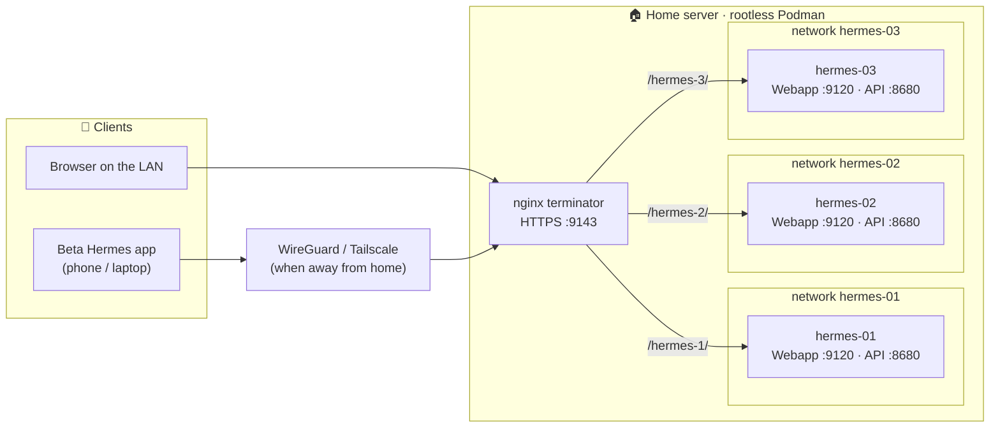

## tldr; Why? 

1. Having one-nginx-per-hermes is (for now) a waste of resources. 
2. Can use default ports of hermes ecosystem, less changes as agent count scales.
3. Still not using [Tailscale](https://tailscale.com/). Nginx can allow Wireguard access *or* localaccess with source ip checking on the cheap, in one place.

### Several Hermes agents, one HTTPS port. 

Config: [5L-Labs/hermes-agents-infra](https://github.com/5L-Labs/hermes-agents-infra). Feel free to fork / try-out. Depends on other work to use quadlets.

<!-- truncate -->

## What does it look like?



## More Technical Details?

- `/hermes-N/` (1–99) → container `hermes-01` … `hermes-99` (two-digit name) via Podman DNS
- Prefix stripping + `X-Forwarded-Prefix`, WebSockets, no buffering
- One certificate; separate `/external-api/` mount (8680)

```nginx
# Excerpt: the Podman DNS resolver and the maps behind $hermes_container,
# $hermes_port and $hermes_connection are in the full nginx.conf.
location ~ ^/hermes-(?<hermes_instance>[1-9][0-9]?)(?<hermes_external_api>/external-api(?=/|$))?(?<hermes_path>/.*)?$ {
    # /hermes-1 -> /hermes-1/
    if ($hermes_path = "") {
        return 308 /hermes-$hermes_instance$hermes_external_api/$is_args$args;
    }

    set $hermes_prefix /hermes-$hermes_instance$hermes_external_api;
    set $hermes_target $hermes_container:$hermes_port;
    rewrite ^/hermes-[1-9][0-9]?(?:/external-api)?(/.*)$ $1 break;

    # A variable upstream uses Podman DNS at request time, not startup.
    proxy_pass http://$hermes_target;
    proxy_http_version 1.1;
    proxy_set_header Host $http_host;
    proxy_set_header X-Forwarded-Proto $scheme;
    proxy_set_header X-Forwarded-Prefix $hermes_prefix;
    proxy_set_header Upgrade $http_upgrade;
    proxy_set_header Connection $hermes_connection;
    proxy_buffering off;
    proxy_read_timeout 600s;
}
```

## Container orchestration

- One Podman network per agent; only nginx joins all, forwarding off
- nginx: read-only rootfs, `NoNewPrivileges`, PID limit
- Each agent trusts only nginx's address

```yaml
webapp:
  enabled: true
  host: 0.0.0.0
  port: 9120
  public_url: https://hermes.example.com:9143/hermes-1
dashboard:
  trusted_proxies:
    - 10.203.1.10   # nginx's address on this agent's network
```

## Getting in from outside

- HTTPS 9143 is never forwarded; come in over [WireGuard](/self-hosted-iot/wireguard-silent-failures) (its own UDP port) or Tailscale
- Password sign-in = trusted LAN/VPN only (Hermes docs)
