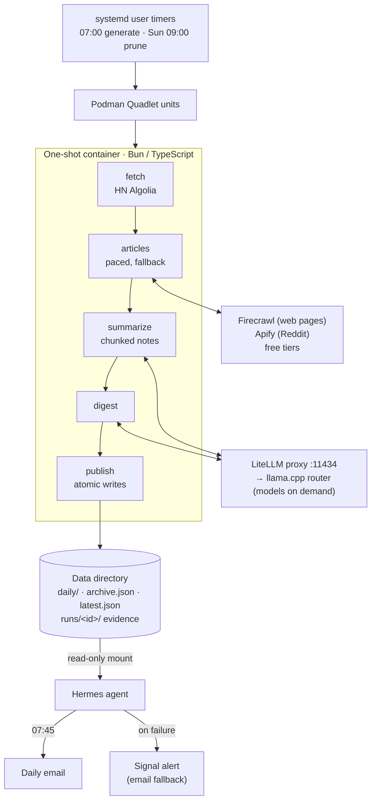

## tldr;

1. [HackerNews](https://news.ycombinator.com/) is great - unfortunately I can't keep up with content and comments every day.
1. [HN Brief](https://github.com/jnd0/hn-brief) was great - but it stopped publishing after 2026-07-16.
2. I [forked it](https://github.com/NickJLange/hn-brief) and run it at home, with:
   - Local models doing all the summarizing.
   - [Apify](https://apify.com/automation-lab/reddit-scraper) for reddit posts
   - [Firecrawl](https://www.firecrawl.dev/) for general website contents
2. The output is no longer a website. It is a folder of JSON and Markdown
3. Hermes (could be any agent) summarizes and delivers daily, weekly and monthly breakdowns of content

Code/Config is yours. This is one dataset that is part of daily "what changed in the world" to cut down on the amount of information to process upfront while still allowing me to dive-deep where I want to.

## What it costs

- **Services:** $0 a month at this volume. Firecrawl uses about 19 credits a day of the free plan's 1,000 a month, and Reddit posts fit inside Apify's free $5 a month of credit.
- **Compute:** the home server, which was already running the model server and Hermes.
- **Time:** about 13 minutes of the server's morning.

Caveat Emptor - an LLM wrote the rest of the post describing how it works.

<!-- truncate -->

## What it looks like

Apart from the calls to HN Algolia, Firecrawl, and Apify, everything runs on my home server, Lunar Beacon, under rootless Podman.

Three outside services take part: the public HN Algolia API, which lists the day's top stories; Firecrawl, which returns a web page as clean Markdown; and Apify, which reads Reddit. Firecrawl and Apify are on free tiers, and all three only ever see requests for public Hacker News data and links. Every summary is written by a model running on the same machine. What leaves the house after that is the daily email to me and, when something breaks, a failure alert over Signal (or email).

## How it runs

The pipeline is a one-shot Bun/TypeScript CLI in a rootless Podman container. A systemd user timer starts it at 07:00 through Podman Quadlet units. Each run rebuilds the image from the latest `main` first, so a merged fix is live the next morning without anyone touching the server.

A run goes through five stages:

- **fetch:** the top 20 stories from the last 24 hours, from the HN Algolia API.
- **articles:** the linked page for each story (more on this below).
- **summarize:** a summary of each story and its discussion, from a local OpenAI-compatible model.
- **digest:** one daily overview, from the same model.
- **publish:** `daily/YYYY/MM/DD.json`, a Markdown version, `archive.json`, and `latest.json`.

Each story in the daily JSON also carries its 10 best HN comments, with links. "Best" here is a score based on thread engagement, length, replies, author diversity, and a penalty for depth, so a single deep back-and-forth doesn't take all ten slots.

The LLM endpoint, the model name, and the API keys live in env files on the host, not in git. The repo describes how the pipeline works; the host decides where it points.

## Keeping evidence, and failing safely

Every run keeps its raw inputs and every LLM call (request, response, timing, and token counts) under `runs/<run-id>/`, along with a manifest of stage timings. That sounds like a lot of disk for a news digest, but it pays for itself twice: when a model writes something odd, I can see exactly what it was given, and when I want to compare models, I can rerun them on identical inputs.

The rest of the safety rules are simple:

- A lock prevents two runs from overlapping.
- Nothing is published until every other stage has succeeded, so a failed fetch, summary, or digest publishes nothing.
- `latest.json` is written last, so anything that reads it never sees half a day.
- Secrets are never written to the output files.

A weekly timer (Sunday 09:00) runs `prune --older-than-days 90 --confirm` to delete old run evidence. The published briefings are kept.

For alerts, any failed systemd user service sends me a Signal message through Hermes, with email as a fallback. I considered Discord and rejected it: it can't be trusted with private data.

## Reading the actual article

This was the largest quality improvement, and it's a little embarrassing. The first version's "article summary" was a guess: the model saw the title and the comments, and wrote something that sounded like a summary of the page. Often the comments discuss the article well enough to make that plausible. But a guess that sounds right is worse than one that obviously isn't.

Now each linked page is fetched as clean Markdown through Firecrawl's free plan, and the local model summarizes the page itself. Long pages are split into 12,000-character chunks with 1,000 characters of overlap. The model writes notes for each chunk, then writes the story summary from those notes plus the comments. Nothing is truncated, and the model never has to hold a whole long article in context at once.

PDFs are skipped. Each story records an `articleSource` field: `fetched`, `pdf_skipped`, `fetch_failed`, `self_post`, or `disabled`. That way a reader, human or agent, knows whether a summary came from the article or not.

On a typical day 17 to 19 of the 20 pages are fetched; the rest are self-posts, PDFs, or sites the fetcher doesn't support. Before article fetching, a run took about 12 minutes, with 21 LLM requests and about 89K tokens. Reading the articles roughly doubled the work and the tokens. In exchange, the summaries became concrete: real figures from the article instead of guesses.

## Reddit is closed to scripts

Some HN stories link to Reddit, and Reddit was the one site that wouldn't cooperate. It blocks Firecrawl. It blocks anonymous requests too: even the public `.json` URLs return 403 "blocked by network security" from a home IP. Registering a Reddit API app wasn't a viable option for me either.

So Reddit posts go through Apify's Reddit scraper instead. It costs about 1¢ per post, which fits easily inside Apify's free $5 a month at this volume. If you're building something similar, budget for a scraping service like this or skip Reddit; plain HTTP won't get you there.

## Swapping the model

The model server is llama.cpp in router mode, which loads models on demand, behind a LiteLLM proxy. The pipeline only asks for a model name, `qwen3.8`, so changing which weights answer that name is a model-server change, not a pipeline change.

I recently pointed that name at a heavily compressed model: Qwen3.8-Flash-Next, GSQ Q2, with MTP speculative decoding. Because every run keeps its inputs, I could rerun the same day's stories on both models and compare:

| | Old model (27B, Q5 + MTP) | GSQ Q2 model |
|---|---|---|
| Full run | 24.5 min | 13.4 min |
| Summarize stage | 20 min | 10 min |
| Digest stage | 2.5 min | 72 s |
| LLM requests | 50 | 50 |
| Tokens | ~202K | ~198K |

The GSQ model had zero story failures. Its summaries were about 7% shorter, with the specific details intact. Half the run time for comparable output was an easy decision, and I made it from the saved runs, not from a feeling about which model "seemed smarter."

## Lessons

- **An "article summary" without the article is mostly a guess from the comments.** Fetching the page was the single biggest quality improvement, even though it doubled the work.
- **Reddit is effectively closed to scripts.** Budget for a scraping service or skip it.
- **Keep evidence of every model call.** It turns a model swap into a measurement instead of a vibe.
- **A heavily compressed model can be good enough for summarization,** and much faster. Test it on your own inputs before you assume you need the bigger one.

HN Brief going quiet ended up being useful. The morning summary is back, it reads the articles now, and it's a dataset my agent can use instead of a page I have to visit.
